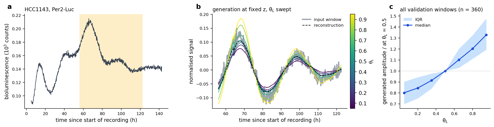

# VABAM-Circadian

**A spin-off of [VABAM](https://github.com/JunetaeKim/VABAM-official): shape–amplitude decoupling applied to circadian bioluminescence reporter recordings.**

VABAM (Variational Autoencoder for Amplitude-based Biosignal Augmentation within Morphological Shape) separates an amplitude code θ (cut-off frequencies of a cascaded filter) from a shape code z (latent variables). It was developed for beat-to-beat pulsatile physiological signals (ABP, ECG). This repository transfers the same model to a different time scale and domain: **~24-h circadian rhythms of *Bmal1*- and *Per2*-luciferase reporters recorded every 10 min in cancer cell lines**.

The official VABAM code is used unchanged: this repository imports it and never modifies or writes into it.

<p align="center">
  
</p>

**(a)** LumiCycle recording of one cell line with a 66.7-h model input window (shaded). **(b)** The window (grey), its reconstruction (dashed) and generations at fixed shape code z with the amplitude code θ<sub>L</sub> swept from 0.05 to 0.95: amplitude changes while phase and period are kept. **(c)** Generated amplitude relative to θ<sub>L</sub> = 0.5 across all validation windows (median and interquartile range).


## What the spin-off adds

- **Time-scale transfer.** The filter cut-off range (`FcLimit`) is re-derived for 10-min sampling so that θ spans the circadian fundamental and its 12-h harmonic. With the official `FcLimit = 1.0`, every cut-off lies far above the circadian band and θ controls nothing (`python run.py filters`, [docs/design_decisions.md](docs/design_decisions.md)).
- **Circadian preprocessing.** Windowed-sinc detrending identical to the authors' pyBOAT pipeline (T_c = 48 h), relative normalisation that keeps damping and relative amplitude, windows of 2–3 cycles (66.7 h), split by recording.
- **Multi-source training and external sets.** Population bioluminescence (Ector et al. 2025) and single-cell fluorescence (Circa-SCOPE, Manella et al. 2021), with held-out experiments as external tests.
- **Label-free model selection and a parameter search** over data mix, cut-off range and latent size, ranked on reconstruction and θ controllability only.
- **Biological read-outs.** Clock-gene knockouts (U-2 OS wild type vs *CRY1* KO vs *CRY1/2* dKO), published circadian phenotypes of breast cancer cell lines, cisplatin and GDSC drug response, and a CCLE → TCGA/METABRIC transcriptome bridge.
- **Representation comparison.** θ + z (VABAM) vs single-z VAEs from the official benchmarks (BaseVAE, β-TC-VAE, conditional VAE) and a linear PCA floor, evaluated by the same downstream analysis.

## Status

Exploratory pilot. VABAM reconstructs circadian recordings well and θ acts as a monotonic, shape-preserving amplitude control at generation time. The inferred θ is constant across inputs by design (θ is sampled during training), so input-level analyses use z and the model's response to θ. Whether the decoupled representation links to drug response or patient outcome better than mixed or linear representations is the open question addressed by `run_exp02.py` and `notebooks/05`.

## Installation

```bash
git clone https://github.com/JunetaeKim/VABAM-official.git
git clone https://github.com/JunetaeKim/VABAM-Circadian.git
cd VABAM-Circadian
pip install -r requirements.txt
```

The official repository is found at `../VABAM-official` by default. Use another location with the environment variable `VABAM_ROOT` or `paths.vabam_root` in `configs/circadian_vabam.yml`.

Tested with Python 3.9 and TensorFlow 2.10 (the official environment). With TensorFlow ≥ 2.16, install `tf-keras`; `TF_USE_LEGACY_KERAS=1` is set automatically.

## Data

The primary dataset, `raw_lumicycle_data.xlsx` (Ector et al., *Mol Syst Biol* 2025; CC BY 4.0), is included in `data/raw/msb2025_breast_cancer/`. Other sources are downloaded separately; see [data/README.md](data/README.md).

| Source | Content | Use |
|---|---|---|
| Ector et al. 2025, *Mol Syst Biol* | 180 LumiCycle recordings, *Bmal1*/*Per2*-Luc, 15 breast cell models + U-2 OS clock-gene KOs | training, exp01, phenotypes |
| Ector et al. 2024, *Nat Commun* | LumiCycle recordings; 29 traces not duplicated in the 2025 set (GIMEN, SH-SY5Y) | external set E2 |
| Manella et al. 2021, *Nat Commun* (Circa-SCOPE) | single-cell Rev-VNP fluorescence, NIH-3T3 | multi-source training, external set E1 |
| Sabherwal et al. 2021, *PNAS* | single-cell mVenus-Hes1, MCF7 | external set E3 |
| cBioPortal datahub; authors' cisplatin imaging | CCLE expression, GDSC AUC, TCGA-BRCA, METABRIC | exp02 (`run_exp02.py fetch`) |

## Usage

```bash
python run.py preprocess                       # MSB 2025 windows -> data/processed/
python run.py filters                          # filter response for the chosen FcLimit
python run.py train --gpu 0                    # default model SKZFC_CIRC_1_30_200
python run.py exp01                            # U-2 OS WT vs CRY1 KO vs CRY1/2 dKO

python run.py audit                            # Nat Commun 2024 vs MSB 2025 duplicates
python run.py multi                            # configuration B: multi-source pool + external sets
python run.py train --model SKZFC_CIRC_1_30_200_MULTI --gpu 0
python run.py external --models SKZFC_CIRC_1_30_200_POP SKZFC_CIRC_1_30_200_MULTI
python run.py select                           # label-free model selection

python run.py sweep --stage s1 --freeze        # parameter search (configs/sweep.yml)
python run.py sweep --stage s1 --worker 0 --nworkers 1 --gpu 0

python run_exp02.py fetch                      # public data for exp02 (~1.4 GB)
python run_exp02.py all --gpu 0                # VABAM vs single-z VAEs vs PCA on downstream tasks
```

All outputs are written under `results/` and `data/processed/`.

## Repository layout

```
VABAM-Circadian/
├── run.py                  command-line entry point
├── run_exp02.py            representation comparison (exp02)
├── configs/
│   ├── circadian_vabam.yml data, preprocessing and VABAM settings
│   └── sweep.yml           parameter search
├── src/
│   ├── vabam_bridge.py     import of the official code, write-path guard
│   ├── viz.py              figures (parameter search, README overview)
│   ├── data/
│   │   ├── loader.py       LumiCycle loaders
│   │   ├── preprocess.py   detrending, normalisation, windows (configuration A)
│   │   ├── multisource.py  multi-source pool, held-out sets, Circa-SCOPE store (configuration B)
│   │   ├── audit.py        duplicate audit between datasets, catalogue of all raw sources
│   │   └── external.py     public downloads; harmonised drug-response, expression and cohort tables
│   ├── model/
│   │   ├── train.py        VABAM training (official ModelCall / DCLCall)
│   │   ├── baseline.py     single-z VAEs from the official benchmarks
│   │   ├── sweep.py, sweep_inspect.py   parameter search and its per-window read-outs
│   │   ├── select_models.py             label-free selection
│   │   └── filter_response.py           filter frequency response vs FcLimit
│   └── analysis/
│       ├── exp01_u2os_cry.py   clock-gene knockout experiment; encode / generate helpers
│       ├── external_eval.py    label-free evaluation on held-out sets
│       ├── damping_test.py     does lowering θ reproduce the amplitude loss within a recording?
│       ├── band_stability.py   reference-band clock stability
│       ├── repmap.py           θ-response / z / z+θ representations
│       └── exp02_analyze.py, exp02_compare.py   downstream evaluation (phenotypes, drugs, transcriptome bridge, survival)
├── notebooks/              03 search, 04 stage analysis, 05 θ+z vs single z, 06 README figure, 07 damping test,
│                           08 band stability, 09 data catalogue
├── docs/design_decisions.md
└── data/                   raw data (primary dataset included) and data/README.md
```

## Citation

If you use this repository, please cite VABAM:

> Kim J. et al. Shape and amplitude decoupling in pulsatile physiological signal synthesis and its evaluation. *Nature Communications* (2026).

and the datasets you use:

> Ector C. et al. Circadian clock features define novel subtypes among breast cancer cells and shape drug sensitivity. *Mol Syst Biol* 21, 315–340 (2025). doi:10.1038/s44320-025-00092-7
>
> Ector C. et al. Time-of-day effects of cancer drugs revealed by high-throughput deep phenotyping. *Nat Commun* 15, 7205 (2024). doi:10.1038/s41467-024-51611-3
>
> Manella G. et al. Circa-SCOPE: high-throughput live single-cell imaging method for analysis of circadian clock resetting. *Nat Commun* 12, 5903 (2021). doi:10.1038/s41467-021-26210-1
>
> Sabherwal N. et al. Differential phase register of Hes1 oscillations with mitoses underlies cell-cycle heterogeneity in ER+ breast cancer cells. *PNAS* 118, e2113527118 (2021). doi:10.1073/pnas.2113527118

## License

Code: MIT (see [LICENSE](LICENSE)). Included data: CC BY 4.0, © the original authors (see [data/README.md](data/README.md)).
